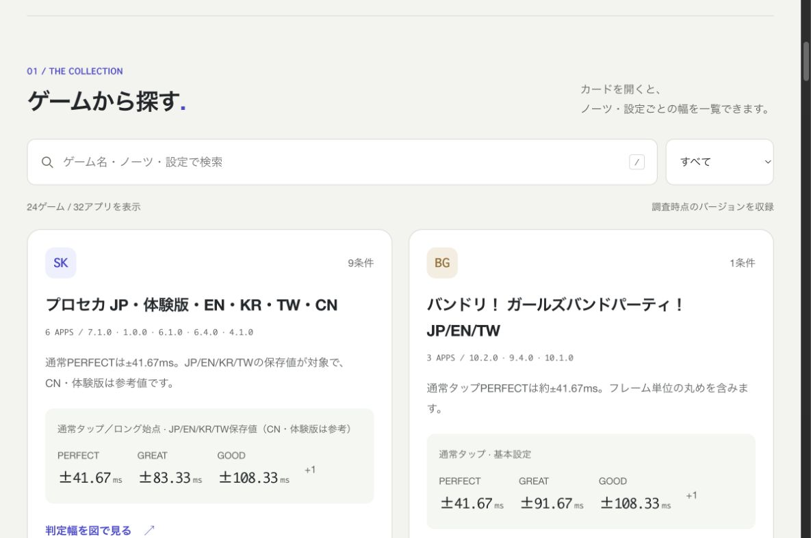

# 音ゲー判定幅図鑑

Galaxyに入っている音ゲーの判定幅を、早・遅の図と一覧で見比べられます。

**[公開サイトを開く](https://galaxy-rhythm-windows.ryuya1adgjmptw.workers.dev/)**

- 32アプリ・24ゲーム・103条件を収録
- ゲーム名・ノーツ・アシスト・モードで検索
- ノーツや設定を切り替えて、早と遅の幅を図で表示
- スマホでも読みやすい大きな文字
- HTML・Markdown・JSONを保存可能

## 一覧を読む・保存する

| 形式     | リンク                                                                                                                                                   |
| -------- | -------------------------------------------------------------------------------------------------------------------------------------------------------- |
| Web      | [判定幅図鑑](https://galaxy-rhythm-windows.ryuya1adgjmptw.workers.dev/)                                                                                  |
| Markdown | [GitHubで読む](docs/JUDGMENT_WINDOWS.md) · [ダウンロード](https://galaxy-rhythm-windows.ryuya1adgjmptw.workers.dev/downloads/galaxy-judgment-windows.md) |
| HTML     | [ダウンロード](https://galaxy-rhythm-windows.ryuya1adgjmptw.workers.dev/downloads/galaxy-judgment-windows.html)                                          |
| JSON     | [判定データ](data/judgment-windows.json)                                                                                                                 |

保存したHTMLは、オフラインでも検索と判定図を使えます。

## 数字の読み方

単位はmsで、早・遅それぞれの半幅です。「±50ms」なら早50ms・遅50msで、全幅は100msです。

2026年11月2日時点の掲載バージョンが対象です。ノーツ・譜面・設定によって値が変わるため、各条件を選んで見てください。

サイトの編集・ビルド・Cloudflare Workersへの公開方法は、[開発ガイド](docs/DEVELOPMENT.md)にまとめています。
